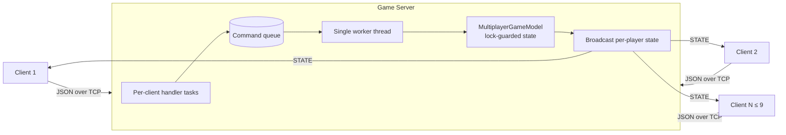

# Multiplayer Dungeon RPG

A concurrent client–server dungeon crawler for the console, written in C# (.NET 9). Up to nine players connect to one server over TCP, explore a procedurally built dungeon, pick up and equip items, and fight enemies that react to players and to noise.

Built as an individual project for the Object-Oriented Design course at Warsaw University of Technology (October 2025 – June 2026), developed in seven staged milestones.

## Highlights

- **Concurrent TCP server** for up to 9 players: one task per client connection, a thread-safe command queue (`ConcurrentQueue` + `AutoResetEvent`) drained by a single worker, and lock-guarded game state, so simultaneous actions are applied in order.
- **Per-player state broadcast**: after every processed action, each client receives its own view of the game state.
- **Custom JSON protocol**: newline-delimited JSON messages over TCP with typed DTOs (`WELCOME`, `STATE`, `ACTION`) covering 12 player actions.
- **Eight design patterns** across about 5,600 lines, 78 classes and 12 interfaces (see below).
- **File logging** of each session, configured through `config.json`.

## Architecture



## Design patterns

| Pattern | Where it is used |
| --- | --- |
| MVC | `MultiplayerGameModel`, `ConsoleGameView`, `GameController` / `KeyboardController` |
| Command | Player actions queued as `PlayerActionCommand` and processed by the server worker |
| Observer | Death and noise events delivered to listeners (`IDeathListener`, `INoiseListener`, `SpeciesGroup`) |
| Visitor | Attack types × weapon types (`IAttackVisitor`: normal, stealth and magical attacks) |
| Strategy | Enemy movement and reactions (`IMovementBehavior`, follow / run away / ignore behaviors), species death reactions, dungeon generation strategies |
| Builder | `DungeonBuilder` assembling the dungeon from `IBuildStep` steps (chambers, paths, central room, items, weapons, enemies) |
| Decorator | Item modifiers wrapping base items (`ItemModifier`, `StrongModifier`, `UnluckyModifier`) |
| Factory | `DungeonThemeFactory` creating library, metal or treasure themes |

## Getting started

Requirements: [.NET 9 SDK](https://dotnet.microsoft.com/download).

```bash
git clone https://github.com/badesalman/multiplayer-dungeon-rpg.git
cd multiplayer-dungeon-rpg

# Start the server (default port 5555)
dotnet run -- --server 5555

# In other terminals, start clients
dotnet run -- --client 127.0.0.1:5555
```

Running without arguments asks whether to start as (S)erver or (C)lient on the local machine.

## Controls

| Key | Action |
| --- | --- |
| W / A / S / D | Move |
| E | Pick up item |
| I | Inventory |
| 1 / 2 / 3 | Normal / stealth / magical attack |
| J | Journal |
| X | Exit |

## Project structure

```
Network/        TCP server, client, JSON protocol and DTOs
model/          Multiplayer game model and command queue
Views/          Console rendering
World/
  Controllers/  Input and game controllers
  Entities/     Player, enemies, items, combat, movement, dungeon builders, logging
```
